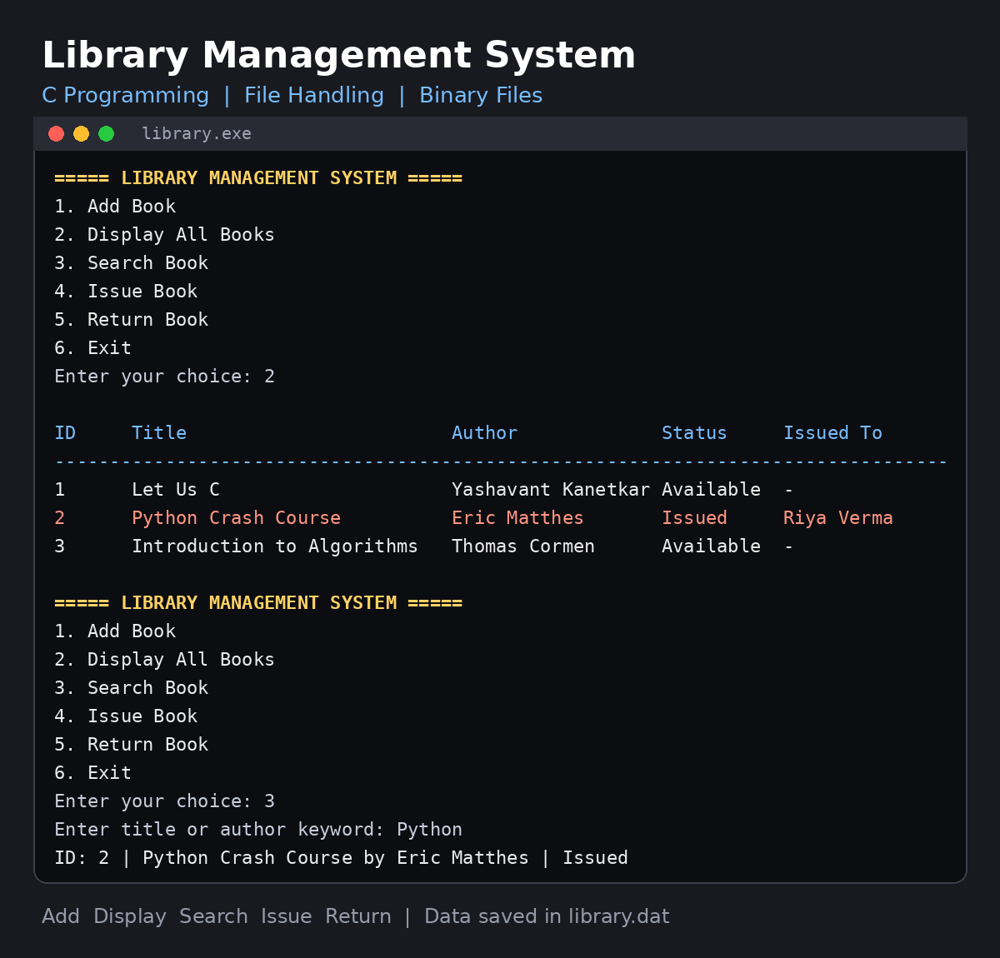

# Library Management System (C)



A menu-driven console application in C to manage a small library.
All data is stored permanently in a binary file (`library.dat`), so
records stay saved after the program closes.

## Features
- Add a book (ID, title, author)
- Display all books with status (Available / Issued) and who has it
- Search by title or author keyword
- Issue a book to a student
- Return a book
- Duplicate book IDs are blocked
- Prevents issuing an already-issued book and returning a book that was never issued

## Concepts Used
- Structures (`struct`)
- File handling: `fopen`, `fread`, `fwrite`, `fseek`
- Binary file modes: `rb`, `ab`, `rb+`
- Updating a record in place using `fseek` with `SEEK_CUR`
- String functions: `strcpy`, `strstr`
- Functions, loops, `switch-case`

## How to Run
```
gcc library_management.c -o library
./library
```
(Windows: `library.exe`)

## Limitations
- Search is case-sensitive
- No option to delete or edit a book
- `library.dat` is a binary file, so it is not human-readable

## Future Improvements
- Case-insensitive search
- Delete / update book
- Issue date and due date with fine calculation
- Input validation for non-numeric IDs
